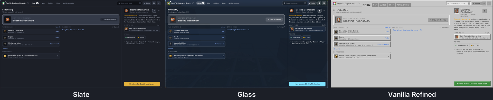

# RYSCore

*Русская версия ниже: [по-русски](#по-русски).*



**The shared core of the RYS family of mods** for Minecraft 1.21.1 on NeoForge. It adds nothing to the game by itself. Every family mod (RYSQuests, RYSIndex, RYSMap, RYSClaims, RYSTeams, RYSHelm) bundles it in its jar, so players never install it separately. When a modpack has several family mods with different core versions, the loader picks the newest one.

This repository is for mod and modpack authors.

## What's inside

- **Themes** Slate, Glass and Vanilla Refined for all family mods at once. A modpack adds its own theme with a resource pack.
- **Windows**: a shared set of elements (header, tabs, buttons, lists, a question dialog), an interface scale of its own, independent of the game's GUI Scale, and the Inter font.
- **Notifications** in the game's toast column: position, sound and volume are up to the player.
- **A button panel** of the family mods next to the inventory.
- **A quick action wheel** and a Keys window: a key for any action of the family mods, with conflicts against other mods' keys shown in the same place.
- **Contracts** between the family mods: teams, land, the map, travel, server permissions, item info, labels in the world, migration from FTB. Each one works without the mod that implements it.

## Documentation

[docs/for-mods.md](docs/for-mods.md) (in Russian): the theme format, the settings files in `config/ryscore/`, migration from FTB, connecting the core to your own mod, and every contract.

History: [CHANGELOG.md](CHANGELOG.md). Help and questions: [Discord](https://discord.gg/Tqgy7acmyd). Bugs: [GitHub Issues](https://github.com/MityaKr/RYSCore/issues).

## Building

You need Java 21.

```
./gradlew build      checks and the jar in neoforge/build/libs
./gradlew publish    the jar into the local maven folder repo/
```

The family mods take the core from `../RYSCore/repo`, so clone this repository next to them and run `publish` before building a mod.

## License

The code is under [MPL-2.0](LICENSE). The graphics and the RYS name remain with the author; the core can be included in any modpack without asking for permission. The Inter and Space Grotesk fonts are under the SIL OFL 1.1. Details in [NOTICE.md](NOTICE.md).

Author: MityaYS, RepkaWorks.

---

## По-русски

**Общее ядро семьи модов RYS** для Minecraft 1.21.1 на NeoForge. Само ничего не добавляет в игру. Оно вложено в jar каждого мода семьи (RYSQuests, RYSIndex, RYSMap, RYSClaims, RYSTeams, RYSHelm), отдельно ставить его не нужно. Если в сборке несколько модов семьи с разными версиями ядра, загрузчик берёт самую новую.

Этот репозиторий для авторов модов и сборок.

### Что внутри

- **Темы** Slate, Glass и Vanilla Refined на все моды семьи сразу. Свою тему сборка добавляет ресурспаком.
- **Окна**: общий набор элементов (шапка, вкладки, кнопки, списки, окно-вопрос), свой размер интерфейса, независимый от GUI Scale игры, шрифт Inter.
- **Уведомления** в колонке тостов игры: место, звук и громкость на выбор игрока.
- **Панель кнопок** модов семьи рядом с инвентарём.
- **Колесо быстрых действий** и окно «Клавиши»: своя клавиша на любое действие модов семьи, там же видны конфликты с клавишами других модов.
- **Контракты** между модами семьи: команды, земля, карта, перемещения, права сервера, сведения о предметах, подписи в мире, переезд с FTB. Каждый работает и без мода, который его реализует.

### Документация

[docs/for-mods.md](docs/for-mods.md): формат темы, файлы настроек в `config/ryscore/`, переезд с FTB, подключение ядра к своему моду и описание контрактов.

История версий: [CHANGELOG.md](CHANGELOG.md). Помощь и вопросы: [Discord](https://discord.gg/Tqgy7acmyd). Баги: [GitHub Issues](https://github.com/MityaKr/RYSCore/issues).

### Сборка

Нужна Java 21. `gradlew build` проверяет и собирает jar в `neoforge/build/libs`, `gradlew publish` кладёт его в локальный maven-каталог `repo/`. Моды семьи берут ядро из `../RYSCore/repo`: клонируй этот репозиторий рядом с ними и выполни `publish` до сборки мода.

### Лицензия

Код под [MPL-2.0](LICENSE). Графика и имя RYS принадлежат автору, ядро можно включать в любую сборку без отдельного разрешения. Шрифты Inter и Space Grotesk под SIL OFL 1.1. Подробности в [NOTICE.md](NOTICE.md).

Автор: MityaYS, RepkaWorks.
